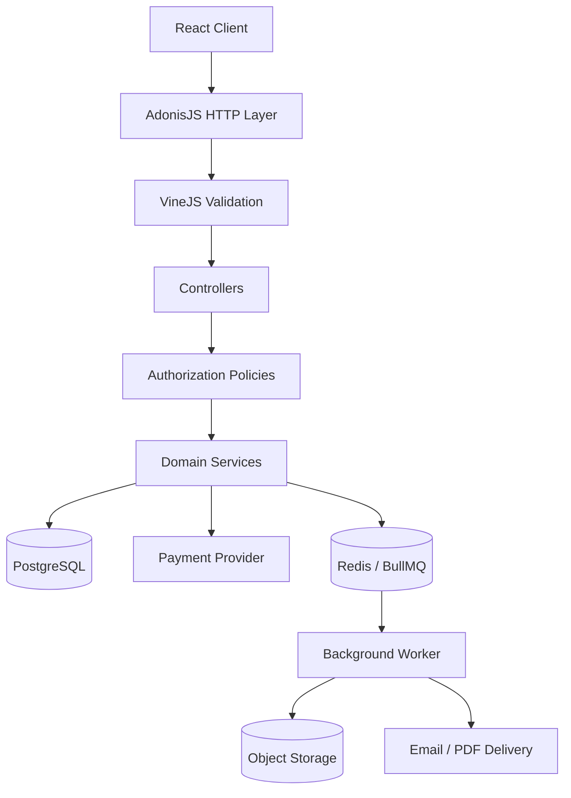

# Enterprise Retail & POS Platform  Engineering Case Study

A documentation-first case study of a multi-tenant retail/POS platform. This repository showcases architecture and representative implementation patterns rather than mirroring the private application repository.

## Overview

The platform brings together catalog and inventory workflows, carts, pricing and tax, checkout, payment integration, merchant/ISO access boundaries, commissions, audit history, and asynchronous document/email processing.

The backend follows a domain-oriented modular monolith structure. Controllers handle transport concerns, domain services coordinate business workflows, policies enforce permissions and query scope, and PostgreSQL protects transactional state.

## Architecture

## Engineering highlights

- Domain boundaries and dependency injection.
- Permission-aware data access and fail-closed query scoping.
- Decimal-based pricing, discounts, tax calculation, and reconciliation.
- Transactional checkout with inventory reservation.
- Database constraints, deferred invariant checks, and audit logging.
- Queue-backed background processing and object-storage integration.

## Documentation

| Topic | Guide |
|---|---|
| System architecture and request lifecycle | [Architecture](docs/architecture.md) |
| Domain responsibilities and service relationships | [Domain map](docs/domain-map.md) |
| Representative TypeScript and SQL examples | [Code examples](docs/code-examples.md) |
| Permissions and record-level scope | [Authorization](docs/authorization.md) |
| Inventory, transactions, and payment failure modes | [Checkout and inventory](docs/checkout-and-inventory.md) |
| Decimal math, discount allocation, and tax | [Pricing and tax](docs/pricing-and-tax.md) |
| Constraints, triggers, and audit trail | [Database integrity](docs/database-integrity.md) |
| Queues, workers, and object storage | [Async processing](docs/async-processing.md) |
| Architecture decision records | [ADRs](docs/decisions/README.md) |
| Mermaid source diagrams | [Diagrams](diagrams/README.md) |

## Technology map

| Layer | Technologies / patterns |
|---|---|
| API | Node.js, TypeScript, AdonisJS 6 |
| Validation | VineJS |
| Web UI | React |
| Persistence | PostgreSQL, Lucid, SQL |
| Financial arithmetic | Decimal.js |
| Authorization | Permission cache and policy-enforced query scopes |
| Background work | Redis, BullMQ |
| File storage | S3-compatible object storage |
| Payments | Tokenized payment-provider flow |

## Contact

**M Nawaz Khan Full Stack Developer**

- GitHub: [Nawaz393](https://github.com/Nawaz393)
- LinkedIn: [Muhammad Nawaz Khan](https://www.linkedin.com/in/nawaz393)

[Documentation index](docs/README.md)
