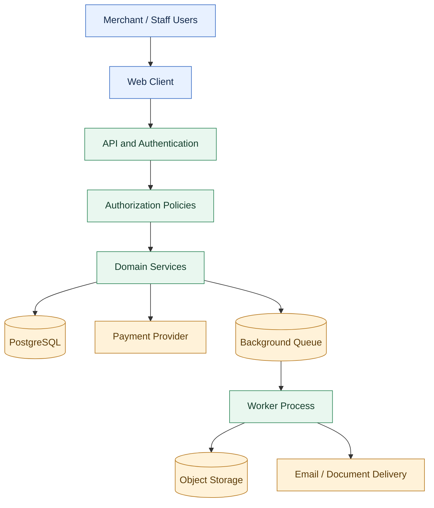

# Enterprise Retail & POS Platform — Architecture Case Study

> A sanitized portfolio case study of a private, multi-tenant retail and point-of-sale platform. The private application source code is intentionally not included.


## Overview

This project covers the architecture of a retail/POS platform with catalog management, inventory, checkout, pricing and tax, payment integration, merchant/ISO relationships, commissions, authorization, audit history, and background processing.

The backend is organized as a **domain-oriented modular monolith**. Domain modules separate business responsibilities while services coordinate workflows that need consistent state.

This public repository is a **documentation-only case study**. It does not contain the private source code or confidential operational details.

## Architecture overview



*Conceptual architecture diagram. Verify actual deployment details before making claims about production infrastructure.*

## Engineering highlights

- **Domain-oriented backend:** separate responsibilities for authentication, merchant/ISO management, catalog, cart, pricing, orders, payments, commissions, and audit.
- **Authorization and record scoping:** resolve permissions and apply the correct organizational or user scope to data access.
- **Financial calculations:** use decimal arithmetic and explicit rounding policies for prices, discounts, taxes, and totals.
- **Checkout consistency:** coordinate inventory, order creation, and payment state with transaction boundaries and defined failure handling.
- **Database integrity:** use constraints, indexes, and triggers for selected invariants and audit history.
- **Asynchronous work:** use queue-backed workers for suitable background tasks and object storage for documents/assets where configured.

## Documentation

Start here, then explore the focused documents:

| Document | What it covers |
|---|---|
| [Architecture](docs/architecture.md) | Overall system layers, components, and design rationale |
| [Domain map](docs/domain-map.md) | Domain responsibilities and service relationships |
| [Authorization](docs/authorization.md) | Authentication, permissions, and tenant-scoped access |
| [Checkout and inventory](docs/checkout-and-inventory.md) | Checkout sequence, row locking, payment outcomes, and failure cases |
| [Pricing and tax](docs/pricing-and-tax.md) | Decimal arithmetic, discounts, tax calculation, and reconciliation |
| [Database integrity](docs/database-integrity.md) | Constraints, deferred checks, and audit history |
| [Async processing](docs/async-processing.md) | Queue-backed jobs, workers, and file delivery |
| [Security and privacy](docs/security-and-privacy.md) | Public disclosure boundaries and security review checklist |
| [Architecture decisions](docs/decisions/README.md) | Short ADRs documenting choices and trade-offs |
| [Diagram source files](diagrams/README.md) | Mermaid source diagrams used in this repository |

## Suggested repository structure

```text
retail-pos-architecture-showcase/
├── README.md
├── docs/
│   ├── README.md
│   ├── architecture.md
│   ├── domain-map.md
│   ├── authorization.md
│   ├── checkout-and-inventory.md
│   ├── pricing-and-tax.md
│   ├── database-integrity.md
│   ├── async-processing.md
│   ├── security-and-privacy.md
│   └── decisions/
│       ├── README.md
│       ├── 001-modular-monolith.md
│       ├── 002-decimal-money.md
│       └── 003-database-invariants.md
└── diagrams/
    ├── README.md
    ├── system-context.mmd
    ├── domain-modules.mmd
    ├── authorization-flow.mmd
    ├── checkout-sequence.mmd
    └── background-processing.mmd
```

## My contribution

Customize this section to reflect your actual work and ownership before publishing.

- Backend architecture and domain/service organization in TypeScript and AdonisJS.
- Service orchestration across cart, pricing, inventory, orders, payments, and commissions.
- Permission policies and scope-aware data access.
- PostgreSQL constraints, transactions, triggers, and audit logging.
- Integration patterns for payment providers, background jobs, and object storage.

Only list responsibilities you personally performed. If a feature was planned or prototyped rather than shipped, say so explicitly.

## Technology choices

| Area | Technology / pattern | Purpose |
|---|---|---|
| Backend | Node.js, TypeScript, AdonisJS 6 | API and domain services |
| Frontend | React | Browser-based user interface |
| Database | PostgreSQL | Transactional system of record |
| Data access | Lucid / SQL | Persistence and query construction |
| Financial math | Decimal arithmetic | Controlled precision and rounding |
| Authorization | Permission policies and scoped queries | Action checks and record-level access |
| Background processing | Redis-backed queue/workers, where configured | Retryable tasks |
| File handling | Object storage, where configured | Documents and assets |
| Payments | Tokenized/hosted payment flow | Reduce direct handling of card details |

Remove any technology or deployment claim that you cannot substantiate. In particular, application-level query scoping is not automatically equivalent to PostgreSQL-native Row-Level Security (RLS), and payment tokenization alone does not establish PCI-DSS compliance.

## Contact

**M Nawaz Khan — Full Stack Developer**

- Portfolio: [mnawaz.me](https://mnawaz.me)
- GitHub: [Nawaz393](https://github.com/Nawaz393)
- LinkedIn: [Muhammad Nawaz Khan](https://www.linkedin.com/in/muhammad-nawaz-khan-69048724b/)

---

*Prepared as a sanitized portfolio template. Review every project-specific statement and obtain client/employer approval before publishing.*
