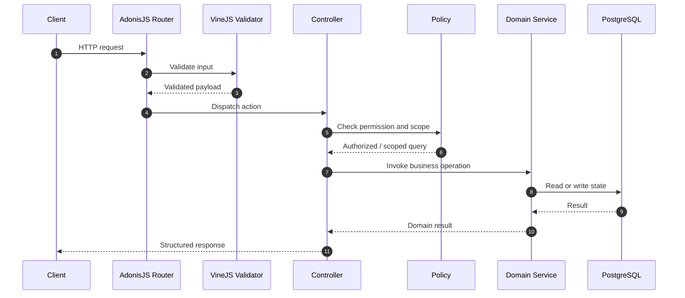

# System Architecture

[← Main README](../README.md) · [← Documentation index](README.md)

## Request lifecycle

## Responsibilities

- **Routes/controllers:** HTTP concerns, request orchestration, and response formatting.
- **VineJS schemas:** reject malformed request payloads before business operations.
- **Policies:** check action permissions and determine permitted record scope.
- **Domain services:** implement business rules and coordinate workflows.
- **Lucid / SQL:** persistence and query construction.
- **PostgreSQL:** transactions, constraints, indexes, and durable state.
- **Redis/BullMQ workers:** asynchronous tasks that should not block requests.

## Why a modular monolith?

Modules share one application runtime and can participate in a common database transaction when required. This reduces deployment and distributed-transaction overhead compared with splitting every domain into an independent service. The trade-off is that module boundaries need explicit ownership and tests to prevent circular dependencies.

Related: [Domain map](domain-map.md) · [Code examples](code-examples.md) · [Checkout](checkout-and-inventory.md)
