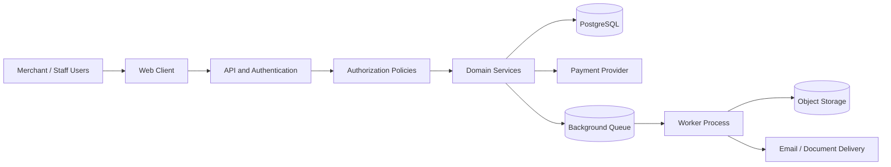
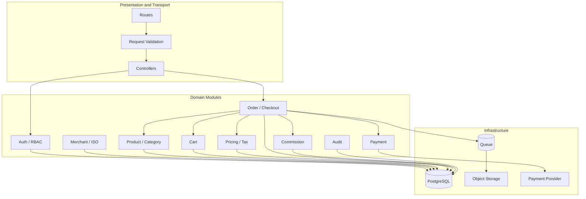

# System Architecture

[← Main README](../README.md) · [← Documentation index](README.md)

## Summary

The platform is represented as a domain-oriented modular monolith. HTTP transport and validation are kept separate from business workflows. Domain services coordinate catalog, cart, pricing, order, payment, and commission behavior; PostgreSQL stores transactional state, while queue workers and object storage support asynchronous operations where configured.

## Component responsibilities

| Component | Responsibility |
|---|---|
| Web client | Presents workflows and submits API requests |
| API / transport | Routes requests, validates input, and formats responses |
| Authentication | Establishes the identity associated with a request |
| Authorization policies | Check allowed actions and determine permitted data scope |
| Domain services | Implement business rules and coordinate workflows |
| PostgreSQL | Persists transactional data and enforces database constraints |
| Payment provider | Processes payment operations through the configured integration |
| Queue | Holds asynchronous work for processing |
| Worker | Performs retryable tasks outside the request lifecycle |
| Object storage | Stores generated documents and application assets |

## Context diagram

## Why a modular monolith?

A modular monolith can keep deployment and transaction coordination simpler than splitting every domain into a separate service. The trade-off is that boundaries must be enforced through clear ownership, explicit service interfaces, and tests that discourage cross-domain shortcuts.

## Request flow

1. The client submits a request.
2. The API validates its shape and authenticates the caller.
3. Authorization checks the requested action and data scope.
4. A domain service executes the business operation.
5. The database reads or writes are performed, often within a transaction for multi-step changes.
6. The API returns a structured result.

