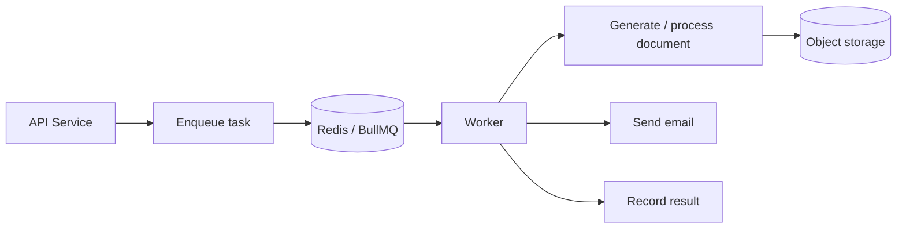

# Asynchronous Processing

[← Main README](../README.md) · [← Documentation index](README.md)

Queue-backed workers can isolate retryable tasks such as email delivery and PDF generation from the HTTP request lifecycle.

## Reliability checklist

- Make jobs idempotent where possible.
- Use bounded retries and backoff for transient errors.
- Separate permanent errors from retryable ones.
- Record job status and attempts without logging secrets.
- Provide a way to inspect and replay failed jobs.
- Use private object storage and controlled download links for private files.
- Reconcile database records and stored files; clean up orphaned objects.

[Diagram source](../diagrams/background-processing.mmd)
