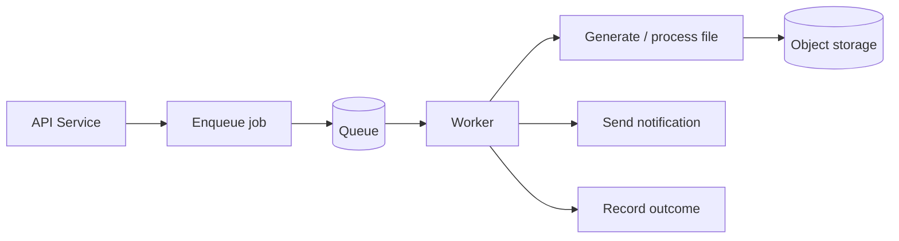

# Asynchronous Processing and File Storage

[← Main README](../README.md) · [← Documentation index](README.md)

## Purpose

Tasks such as email delivery and document generation can run in background workers rather than extending the duration of an API request. Object storage can hold generated files and application assets where configured.

## Conceptual workflow

See [`../diagrams/background-processing.mmd`](../diagrams/background-processing.mmd).

## Reliability practices

- Make jobs idempotent where possible.
- Set bounded retry policies and backoff for transient failures.
- Separate permanent errors from retryable errors.
- Capture job status, attempts, duration, and failure reason without logging secrets.
- Define how failed jobs are inspected and replayed.
- Use private storage and short-lived signed URLs or authenticated downloads for sensitive documents.
- Keep the database record and file lifecycle consistent, including cleanup for orphaned files.

Only describe the queue provider, object-storage service, and deployment model as active production components if that is verified.
