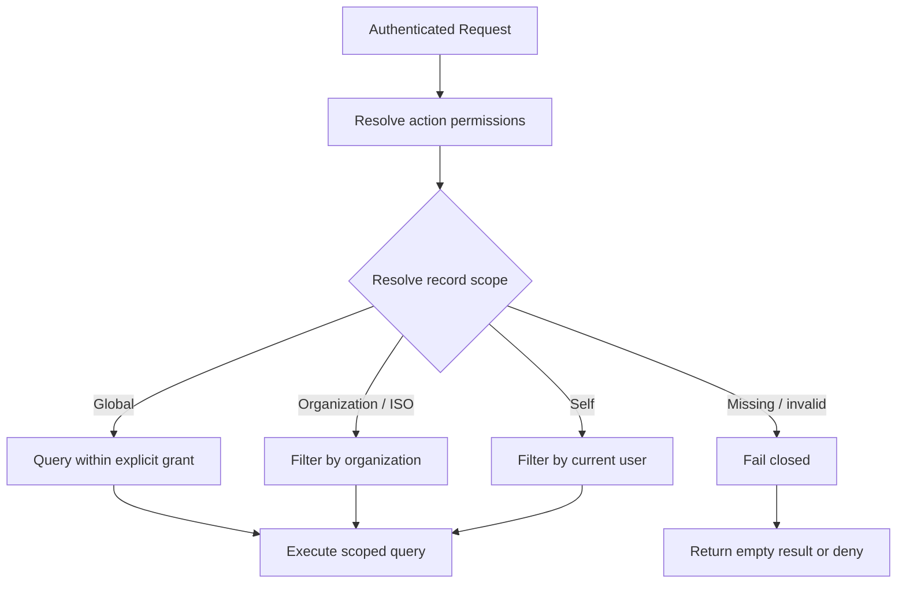

# Authorization and Tenant Scoping

[← Main README](../README.md) · [← Documentation index](README.md) · [Code examples](code-examples.md)

Two checks are needed for protected operations:

1. **Action permission:** may this caller perform the operation?
2. **Record scope:** which rows may the caller access?

A missing or invalid scope must not fall back to an unrestricted query. See the [scoping example](code-examples.md#1-fail-closed-query-scoping).

| Scenario | Expected behavior |
|---|---|
| Explicit global-view permission | Allow only the operations covered by that permission |
| Organization scope | Constrain query to the authorized organization |
| Self scope | Constrain query to the current user |
| Missing relationship | Fail closed |
| Bulk operation or export | Apply equivalent permission and scope rules |
| Background job | Resolve tenant/actor context explicitly |

Application-level query scoping is not automatically PostgreSQL-native Row-Level Security (RLS). Claim database RLS only if database policies are configured and verified.
