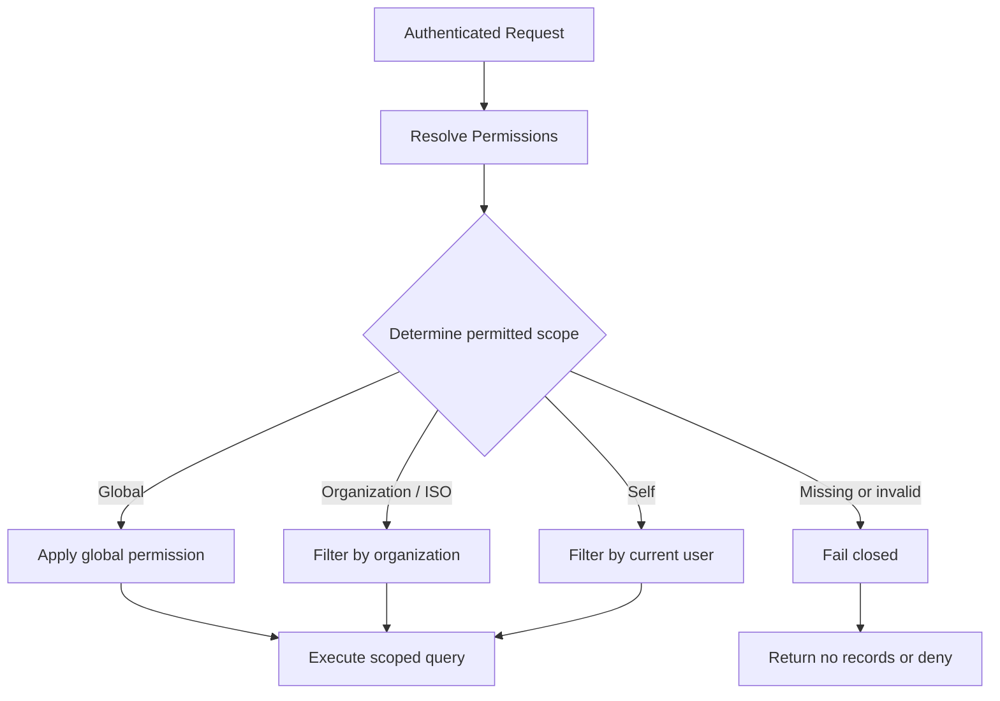

# Authorization and Tenant Scoping

[← Main README](../README.md) · [← Documentation index](README.md)

## Two authorization questions

Every protected operation should answer:

1. Is the caller permitted to perform this action?
2. Which records can the caller access?

Action permissions and record scoping are related but distinct. A user may be allowed to view merchants within a specific organization without being allowed to view every merchant in the system.

## Conceptual flow

See [`../diagrams/authorization-flow.mmd`](../diagrams/authorization-flow.mmd).

## Fail-closed behavior

If a policy cannot establish a valid permitted scope, the operation should not fall back to an unrestricted query. Depending on the operation, the safe outcome may be an empty result or an authorization error.

## Important terminology

Application-level policy-enforced query scoping is **not automatically PostgreSQL-native Row-Level Security (RLS)**. Only claim database RLS if PostgreSQL policies are actually configured and verified.

## Security test matrix

Test at least the following cases with synthetic identities and records:

- A user can access records within their permitted scope.
- A user cannot read or mutate records outside that scope.
- Missing organization relationships do not grant broad access.
- Bulk actions and exports apply the same scope restrictions.
- Background jobs enforce the correct tenant boundary.
- Permission-cache invalidation does not preserve revoked access.
- Object-storage access checks match the application authorization model.

Do not include real tenant identifiers, tokens, private URLs, or production data in public examples.
