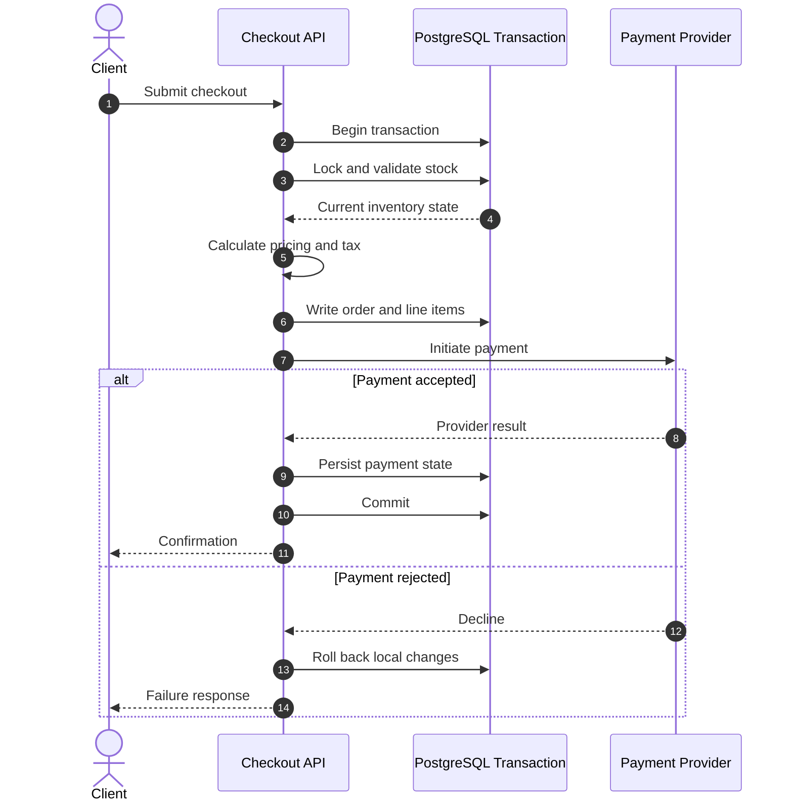

# Checkout and Inventory Consistency

[← Main README](../README.md) · [← Documentation index](README.md) · [Code examples](code-examples.md)

A row lock can serialize competing attempts to reserve the same inventory row. See the [transactional stock example](code-examples.md#3-transactional-inventory-reservation).

## External payment caveat

A database rollback cannot undo an external payment-provider side effect. Timeouts can leave the provider outcome unknown, or the provider may approve just before the application fails to persist the result.

A robust workflow should consider idempotency keys, explicit payment states, verified webhooks, retry safety, reconciliation, and inventory release/compensation rules.

## Test scenarios

- Two checkouts compete for the final stock unit.
- The same request is submitted twice.
- Payment is declined or times out.
- Payment succeeds but the local transaction fails to commit.
- A webhook or worker retries an already-processed event.
