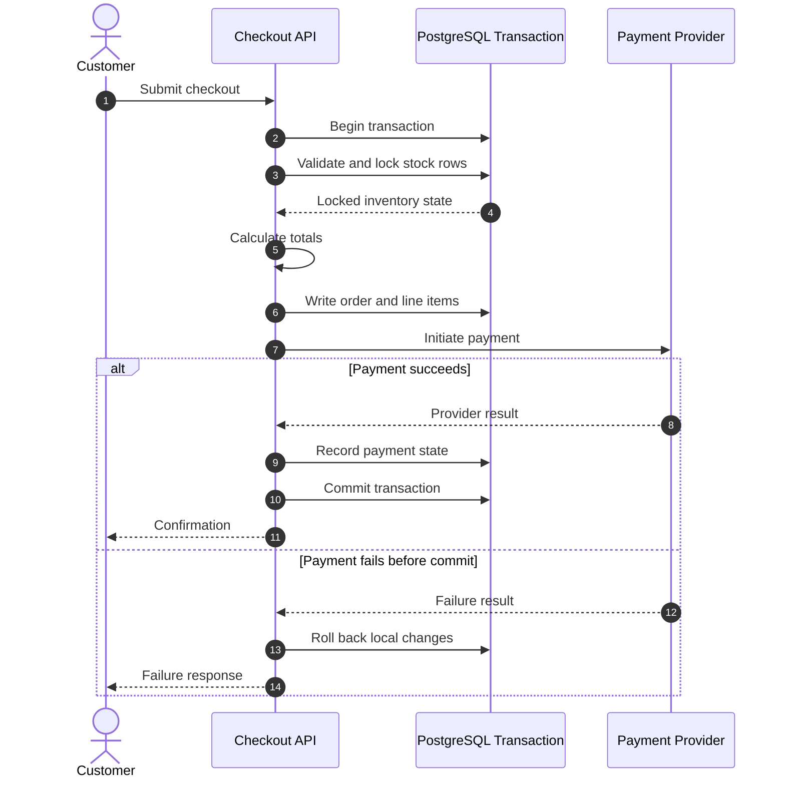

# Checkout and Inventory Consistency

[← Main README](../README.md) · [← Documentation index](README.md)

## Goal

Checkout coordinates inventory, pricing, order creation, payment, and any related commission records. The workflow must handle concurrent requests and partial failures deliberately.

## Conceptual sequence

Source: [`../diagrams/checkout-sequence.mmd`](../diagrams/checkout-sequence.mmd).

## Inventory locking

Row-level locks, used inside a transaction, can prevent competing checkouts from successfully reserving the same limited stock. The exact lock order, validation strategy, and isolation assumptions should be documented and tested.

## Payment boundary caveat

A PostgreSQL transaction cannot roll back an external payment-provider side effect. A timeout may leave the provider's outcome unknown, and the provider may approve a payment just before the application fails to persist the result.

A robust integration should consider:

- Idempotency keys for repeated checkout attempts.
- Explicit pending, succeeded, failed, and reconciliation-required states.
- Webhook verification and replay protection.
- Retry policies that do not duplicate charges.
- Reconciliation for provider-approved payments missing from local records.
- Inventory release or compensation policies for abandoned/failed workflows.

Do not describe this as a distributed ACID transaction unless a genuine distributed transaction mechanism exists.

## Test scenarios

- Two customers attempt to purchase the final unit concurrently.
- The same checkout request is submitted twice.
- Payment is declined.
- The provider times out with an unknown outcome.
- Payment succeeds but the application crashes before committing locally.
- A worker or webhook retries an already-processed event.
