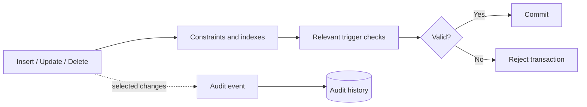

# Database Integrity and Audit History

[← Main README](../README.md) · [← Documentation index](README.md) · [Code examples](code-examples.md)

## Patterns

- Partial unique indexes for conditional uniqueness.
- `CHECK` constraints for row-level invariants.
- Foreign keys for referential integrity.
- Deferred constraint triggers for cross-row rules evaluated at commit.
- Audit triggers for selected before/after snapshots.

See [SQL examples](code-examples.md#4-database-constraints) and the [audit trigger example](code-examples.md#5-audit-trigger-pattern).

Test deferred constraints, migrations, bulk writes, trigger performance, retention, and audit access controls. Audit payloads should not store credentials, payment data, or unnecessary personal information.
