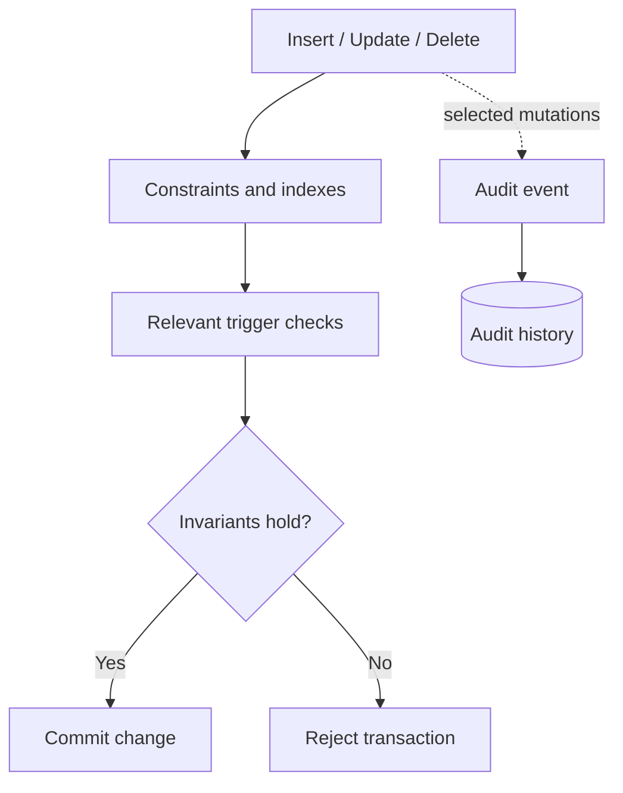

# Database Integrity and Audit History

[← Main README](../README.md) · [← Documentation index](README.md)

## Why database invariants matter

Application validation provides useful feedback, but important rules should also be enforced by the database when practical. Database constraints protect data when writes originate from multiple code paths, provided those paths use the same constrained database.

## Patterns

- **Unique and partial unique indexes:** enforce uniqueness for the relevant subset of rows.
- **CHECK constraints:** reject rows that violate local data rules.
- **Foreign keys:** protect relationships between records.
- **Deferred constraint triggers:** validate certain cross-row invariants at transaction commit.
- **Audit records:** retain selected before/after values for traceability.

## Conceptual write lifecycle

## Operational considerations

- Test constraints with both valid and invalid data.
- Ensure deferred checks work for multi-row operations.
- Plan migrations and rollback behavior carefully.
- Review trigger performance on bulk writes.
- Restrict access to audit records and define retention.
- Avoid logging secrets or unnecessary personal/payment information.
- Monitor audit-table growth and index overhead.

This public document intentionally avoids reproducing the complete private schema or production migrations.
