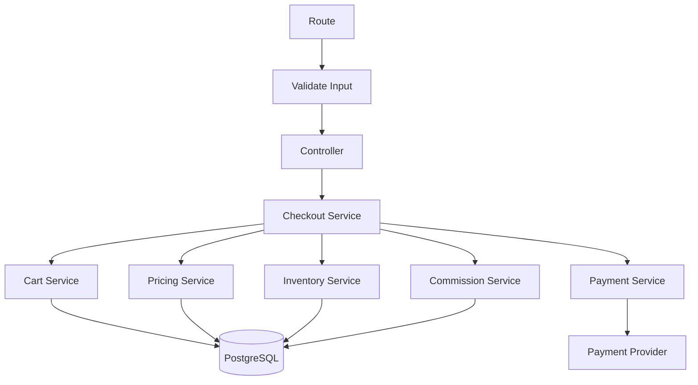

# Domain Map

[← Main README](../README.md) · [← Documentation index](README.md)

## Domain responsibilities

| Domain | Responsibility |
|---|---|
| Auth / RBAC | Authentication, roles, permissions, and permission lookup |
| Merchant / ISO | Organizational relationships and scoped access |
| Product / Category | Catalog data, product variants, categories, and related assets |
| Cart | Cart state and selected items |
| Pricing / Tax | Price calculation, discounts, tax rules, and totals |
| Order / Checkout | Coordinates checkout and order lifecycle |
| Payment | Payment-provider integration and payment state |
| Commission | Commission calculation/recording for applicable workflows |
| Audit | Records selected changes for traceability |

The table is a high-level public description. Adjust it to match the actual modules and their ownership.

## Interaction pattern

Controllers should remain focused on transport-level concerns. Services own business operations and call other domain services through explicit interfaces or injected dependencies.

## Boundary guidelines

- Avoid duplicating another domain's business rules.
- Keep shared workflows explicit in orchestration services.
- Pass transaction context deliberately when multiple operations must commit or roll back together.
- Avoid hidden circular dependencies between domains.
- Test domain behavior separately from HTTP transport when practical.

[View the domain diagram source](../diagrams/domain-modules.mmd)
