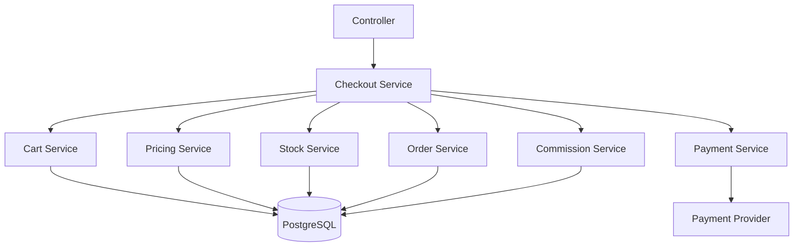

# Domain Map and Service Boundaries

[← Main README](../README.md) · [← Documentation index](README.md)

| Domain | Responsibility |
|---|---|
| Auth / RBAC | Authentication, roles, permissions, permission lookup |
| Merchant / ISO | Organizational hierarchy and access boundaries |
| Product / Category | Catalog, variants, bundles, categories, assets |
| Cart | Cart state and selected items |
| Pricing / Tax | Discounts, tax rules, charge calculation, reconciliation |
| Order / Checkout | Coordinates stock, pricing, order creation, payment, finalization |
| Payment | Provider integration and payment state |
| Commission | Commission calculation and recording |
| Audit | Selected change history |
| Storage / Worker | Generated documents, email delivery, queued work |

## Dependency direction



## Dependency injection

```ts
import { inject } from '@adonisjs/core'
import { PricingService } from '#pricing/services/pricing_service'
import { StockService } from '#product/services/stock_service'
import { PaymentService } from '#payment/services/payment_service'

@inject()
export class CheckoutService {
  constructor(
    private readonly pricingService: PricingService,
    private readonly stockService: StockService,
    private readonly paymentService: PaymentService,
  ) {}

  // Coordinate workflow here; keep HTTP details in controllers.
}
```

Explicit collaborators make the workflow easier to inspect and test.

[More implementation examples](code-examples.md)
