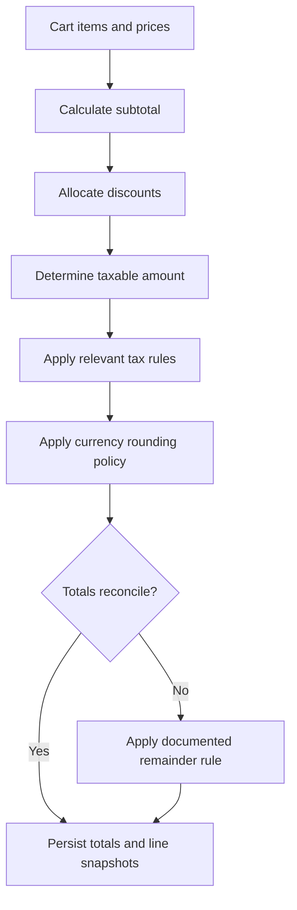

# Pricing, Discounts, and Tax

[← Main README](../README.md) · [← Documentation index](README.md)

## Objective

Currency calculations require controlled precision and a clearly specified rounding policy. Binary floating-point arithmetic should not be used as the default representation for financial amounts.

## Calculation flow

## Design considerations

- Use decimal arithmetic for intermediate values.
- Specify the rounding mode and when rounding occurs.
- Define how discounts are allocated across bundle components.
- Explain how a rounding remainder is assigned.
- Reconcile line-item totals with the order total.
- Store a snapshot of the prices, discounts, and tax values used at checkout.
- Test boundary values, zero/negative inputs where relevant, and refund calculations.

## Rounding is a business rule

A decimal library can provide predictable arithmetic, but it cannot decide the correct tax policy or accounting treatment. Those rules must be validated against the relevant business and jurisdiction requirements.

## Suggested synthetic example

Add a small worked example using fabricated prices and a clearly stated rounding policy. Do not use customer orders or proprietary pricing rules unless explicitly approved for disclosure.

[View the diagram source](../diagrams/pricing-and-tax.mmd)
