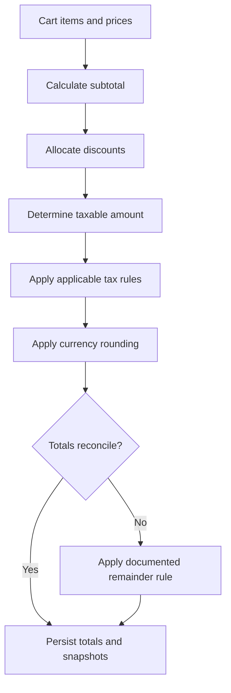

# Pricing, Discounts, and Tax

[← Main README](../README.md) · [← Documentation index](README.md) · [Code examples](code-examples.md)

## Bundle discount allocation

A proportional allocation can use each component's share of the bundle's list price:

$$
w_i = \frac{p_i}{\sum_{j} p_j}
$$

$$
d_i = D \times w_i
$$

Here, \(p_i\) is the component's list-price contribution and \(D\) is the total discount. The implementation must define rounding and how a remaining minor-unit difference is assigned.

## Review checklist

- Define the rounding mode and when rounding occurs.
- Reconcile item totals against the order total.
- Store a snapshot of prices, discounts, and taxes used at checkout.
- Test boundary values, refunds, and partial returns.
- Validate tax rules against applicable business requirements.

See the [Decimal.js example](code-examples.md#2-decimal-arithmetic). Decimal arithmetic improves numerical control but does not by itself prove accounting or tax compliance.
