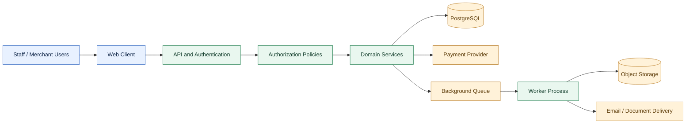
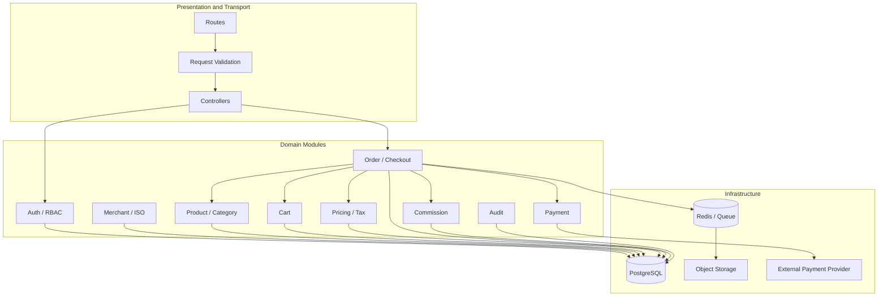
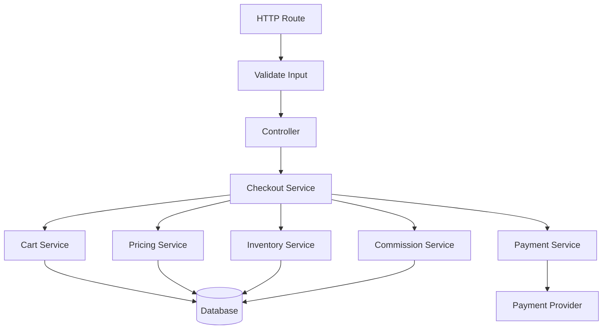
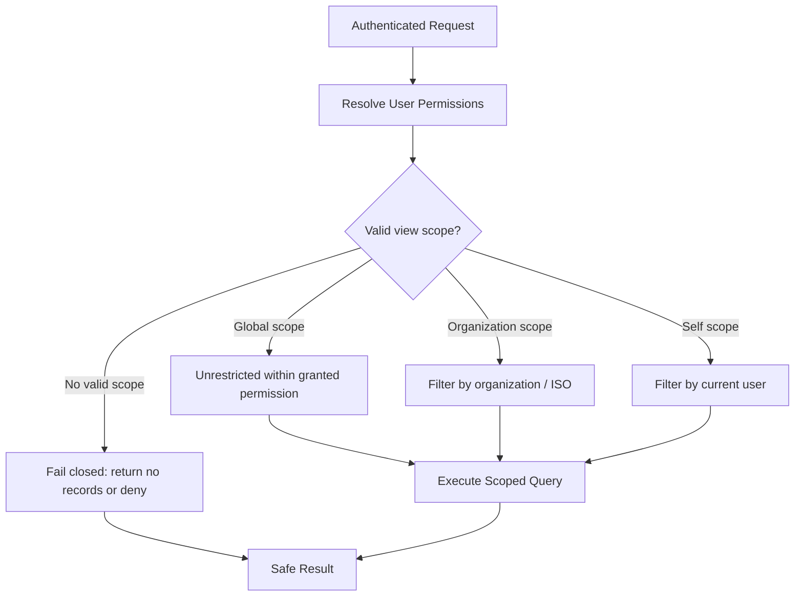
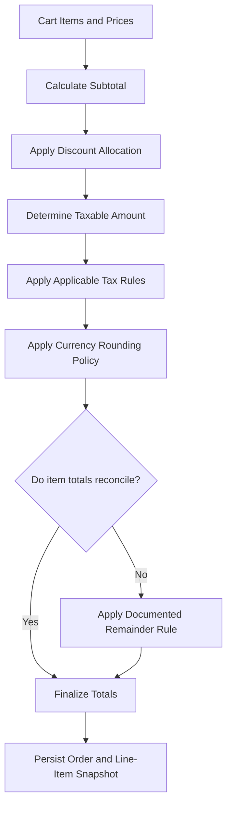
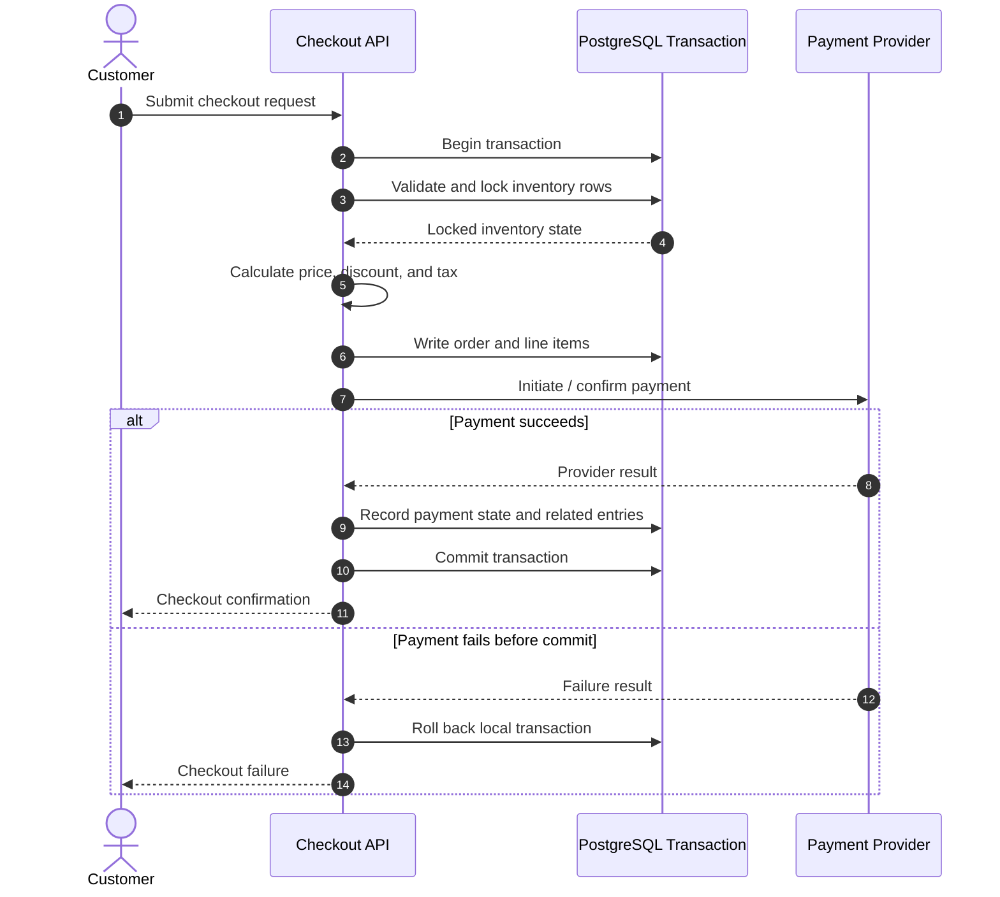
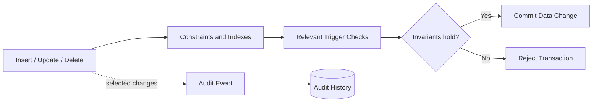
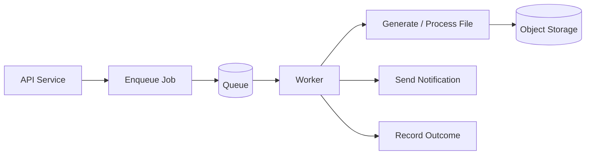
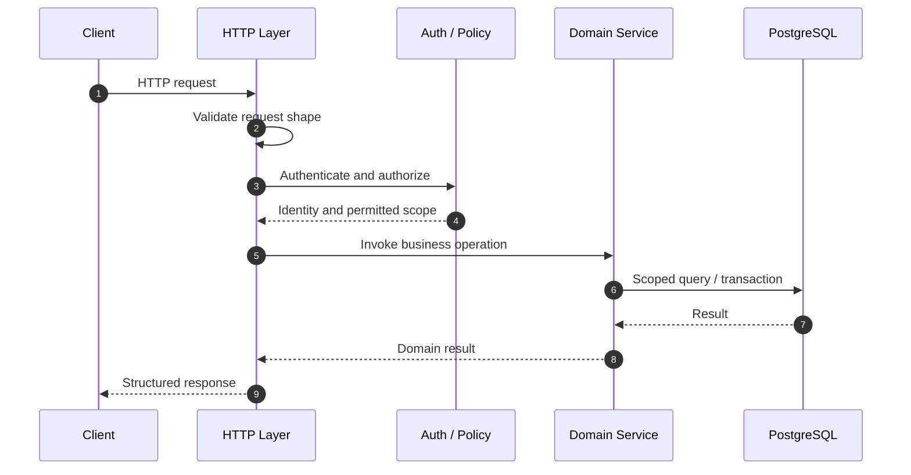

# Enterprise Retail & POS Platform --- Architecture Case Study

> **Portfolio case study for a private project.** This document
> describes selected engineering responsibilities and architectural
> patterns without publishing proprietary source code, customer data,
> credentials, production endpoints, or confidential business rules.


## Contents

-   [Project at a glance](#project-at-a-glance)
-   [My engineering focus](#my-engineering-focus)
-   [System context](#system-context)
-   [Architecture at a glance](#architecture-at-a-glance)
-   [Backend structure](#backend-structure)
-   [Key engineering decisions](#key-engineering-decisions)
    -   [Domain boundaries and dependency
        injection](#1-domain-boundaries-and-dependency-injection)
    -   [Authorization and tenant
        scoping](#2-authorization-and-tenant-scoping)
    -   [Financial precision and
        pricing](#3-financial-precision-and-pricing)
    -   [Checkout and inventory
        consistency](#4-checkout-and-inventory-consistency)
    -   [Database invariants and audit
        history](#5-database-invariants-and-audit-history)
    -   [Background processing and object
        storage](#6-background-processing-and-object-storage)
-   [Request lifecycle](#request-lifecycle)
-   [Repository documentation map](#repository-documentation-map)
-   [Technology choices](#technology-choices)
-   [Security and disclosure
    boundaries](#security-and-disclosure-boundaries)
-   [Evidence and limitations](#evidence-and-limitations)
-   [Contact](#contact)

## Project at a glance

A multi-tenant retail and point-of-sale platform designed around catalog
management, orders, payments, inventory, merchant/ISO relationships, tax
calculation, commissions, access control, and auditability.

The backend is organized as a **domain-oriented modular monolith**.
Domain modules have explicit responsibilities, while shared database
transactions and service boundaries coordinate operations that must
remain consistent.

### Problem space

Retail workflows connect many concerns that cannot safely be treated as
unrelated CRUD operations:

-   Product catalog, variants, bundles, and inventory.
-   Cart validation, pricing, discounts, tax, and checkout.
-   Payment-provider interactions and order state changes.
-   Merchant and ISO access scopes.
-   Commission records, audit trails, and operational notifications.

### Engineering priorities

-   **Correctness:** keep money calculations deterministic and protect
    inventory from concurrent checkout attempts.
-   **Authorization:** scope reads and writes to the user's permitted
    organizational boundary.
-   **Maintainability:** keep business responsibilities in focused
    domain modules.
-   **Auditability:** enforce important data rules at the database
    boundary and retain change history.
-   **Operational separation:** move asynchronous work out of request
    handling where appropriate.

## My engineering focus

Use this section to describe only the work you personally performed.
Edit the bullets so they accurately match your contribution before
publishing.

-   Backend architecture and domain/module boundaries in AdonisJS and
    TypeScript.
-   Service orchestration across cart, pricing, inventory, orders,
    payments, and commissions.
-   Role- and scope-aware authorization policies.
-   PostgreSQL constraints, transactions, triggers, and audit logging.
-   Payment-flow integration patterns that avoid handling raw card
    details in the application.
-   Background job and object-storage integration for generated
    documents and assets.

**Portfolio note:** This public case study intentionally does not
include private source files, full database schemas, exact production
topology, live endpoint names, secrets, customer information, or
internal business-specific rules.

## System context

The system supports several application roles and business boundaries. A
request enters through the web client and API layer, is authorized, and
then passes through the relevant domain services. PostgreSQL is the
primary system of record; queues and object storage support asynchronous
work and file handling.



*Diagram is a conceptual view for portfolio communication, not a
deployment manifest. Confirm the actual deployed topology before making
claims about production infrastructure.*

## Architecture at a glance



### How to read this diagram

-   **Presentation and transport** handle HTTP routing, input
    validation, and request/response concerns.
-   **Domain modules** own related business behavior and expose services
    to other modules.
-   **Infrastructure** provides persistence, queueing, file storage, and
    external payment connectivity.
-   The diagram is intentionally simplified: it communicates
    responsibilities rather than every dependency or runtime connection.

## Backend structure

A clean public repository can present the project documentation without
copying private application code. One possible documentation-only layout
is:

``` text
retail-pos-architecture/
├── README.md
├── docs/
│   ├── architecture.md
│   ├── domain-map.md
│   ├── authorization.md
│   ├── checkout-and-inventory.md
│   ├── pricing-and-tax.md
│   ├── database-integrity.md
│   ├── async-processing.md
│   ├── security-and-privacy.md
│   └── decisions/
│       ├── 001-modular-monolith.md
│       ├── 002-decimal-money.md
│       └── 003-database-invariants.md
├── diagrams/
│   ├── system-context.mmd
│   ├── domain-modules.mmd
│   ├── authorization-flow.mmd
│   └── checkout-sequence.mmd
└── assets/
    └── architecture-overview.png
```

This is a **suggested structure for the public case-study repository**,
not a claim about the layout of the private source repository. Add each
file only when it exists. The links below point to the suggested paths
and will work once you create those files in the same repository.

### Documentation index

  --------------------------------------------------------------------------------------------------------
  Document                                                             Purpose
  -------------------------------------------------------------------- -----------------------------------
  [`docs/architecture.md`](docs/architecture.md)                       Overall architecture, boundaries,
                                                                       and infrastructure assumptions.

  [`docs/domain-map.md`](docs/domain-map.md)                           Module responsibilities and allowed
                                                                       cross-domain interactions.

  [`docs/authorization.md`](docs/authorization.md)                     Authentication, permissions, and
                                                                       tenant-scope enforcement.

  [`docs/checkout-and-inventory.md`](docs/checkout-and-inventory.md)   Checkout sequence, inventory
                                                                       reservation, transaction behavior,
                                                                       and failure cases.

  [`docs/pricing-and-tax.md`](docs/pricing-and-tax.md)                 Decimal arithmetic, discounts,
                                                                       bundle allocation, and tax
                                                                       calculation.

  [`docs/database-integrity.md`](docs/database-integrity.md)           Constraints, deferred checks, and
                                                                       audit-event design.

  [`docs/async-processing.md`](docs/async-processing.md)               Queue-backed jobs, document
                                                                       generation, and object-storage
                                                                       flows.

  [`docs/security-and-privacy.md`](docs/security-and-privacy.md)       Public disclosure policy and
                                                                       security considerations.

  [`docs/decisions/`](docs/decisions/)                                 Short Architecture Decision Records
                                                                       (ADRs) explaining why key choices
                                                                       were made.
  --------------------------------------------------------------------------------------------------------

## Key engineering decisions

### 1. Domain boundaries and dependency injection

The application groups business responsibilities into domains such as
authentication, merchant/ISO management, catalog, cart, pricing, orders,
payments, commissions, and audit. Controllers coordinate HTTP requests;
domain services contain workflow logic; injected dependencies make
service collaboration explicit and easier to test.



**Why this matters:** checkout has to coordinate multiple business
capabilities. Clear service contracts make the workflow easier to review
than embedding all of the logic in one controller.

**Trade-off:** a modular monolith keeps deployment and transaction
coordination comparatively straightforward, but module boundaries still
need discipline to avoid hidden coupling.

### 2. Authorization and tenant scoping

Authorization needs to answer two separate questions:

1.  Is this user allowed to perform the requested action?
2.  Which records is this user allowed to see or modify?

A policy can resolve a permitted scope---for example, global,
organization-scoped, or self-scoped access---and apply it to the
database query. The safe default is to return no records when a valid
scope cannot be established.



**Important distinction:** application-level query scoping is not the
same thing as PostgreSQL-native Row-Level Security (RLS). Unless
database policies are independently configured and verified, describe
this pattern as **policy-enforced query scoping**, not "database RLS."

**Security review points:** test cross-tenant reads and writes, missing
organization relationships, stale permission caches, bulk operations,
exports, and background jobs. A fail-closed query is one layer of
defense, not a substitute for authorization tests.

### 3. Financial precision and pricing

Binary floating-point values are not a safe default for currency
arithmetic. Decimal arithmetic supports controlled precision and
explicit rounding for discounts, taxes, bundle allocation, and totals.



**Design goals:**

-   Use a decimal library for intermediate calculations.
-   Make rounding rules explicit and consistent.
-   Keep the item-level tax and discount breakdown explainable.
-   Reconcile component totals against the transaction total.
-   Preserve a snapshot of the values used when the order was placed.

**Trade-off:** precise arithmetic does not automatically guarantee
correct accounting. The currency scale, tax rules, rounding point,
refunds, and provider settlement behavior still need tests and domain
review.

### 4. Checkout and inventory consistency

A checkout workflow coordinates stock, order creation, pricing, payment,
and commissions. Database transactions and row locks can protect
inventory updates from competing requests. External payment calls need
special care because a database rollback cannot reverse a payment
provider's already-completed side effect.



**Critical caveat:** this sequence is conceptual. A production-grade
integration must account for timeouts, duplicate requests, retries,
idempotency keys, webhook reconciliation, and the case where the
provider succeeds but the application fails before committing locally.
Do not claim that a database transaction alone provides a distributed
ACID transaction across PostgreSQL and a payment provider.

Recommended tests include simultaneous purchases of the last unit,
repeated checkout submissions, provider timeouts, failed payments, and
recovery after partial failure.

### 5. Database invariants and audit history

Application validation improves user feedback, but the database should
also protect important invariants that must hold regardless of which
code path performs a write.

Examples of patterns documented for this system include:

-   Partial unique indexes for conditional uniqueness.
-   `CHECK` constraints for valid ownership relationships.
-   Deferred constraint triggers for rules that should be checked at
    transaction commit.
-   Audit records that capture relevant before/after values for selected
    mutations.



**Why this matters:** database-level rules remain effective when data is
changed through different application paths, provided those paths use
the same database constraints and triggers.

**Operational considerations:** test bulk operations, trigger behavior,
migration rollback, audit-table growth, retention, and the performance
impact of indexes and triggers. Audit data may itself contain sensitive
values and needs access controls and retention rules.

### 6. Background processing and object storage

Long-running or retryable tasks---such as email delivery and document
generation---can be placed on a queue so API requests do not need to
perform all work synchronously. Object storage can hold generated
documents and other assets, while the worker processes jobs
independently.



**Reliability considerations:** jobs should be idempotent where
possible, retry policies should distinguish transient from permanent
errors, and failed jobs need observability and a recovery path. Use
short-lived signed URLs or authenticated downloads for private files
rather than exposing private object paths.

## Request lifecycle

The following diagram summarizes a typical authenticated read or write
request. Actual paths vary by endpoint.



## Technology choices

  -----------------------------------------------------------------------
  Area                    Technology / pattern    Role
  ----------------------- ----------------------- -----------------------
  Backend                 Node.js, TypeScript,    Typed API and domain
                          AdonisJS 6              services

  Web client              React                   Browser-based
                                                  application interface

  Database                PostgreSQL              Transactional system of
                                                  record

  Data access             AdonisJS Lucid / SQL    Persistence and query
                                                  construction

  Financial math          Decimal arithmetic      Controlled precision
                                                  and rounding

  Authorization           Permission policies and Action checks and
                          scoped queries          record-level access

  Asynchronous work       Redis-backed queue /    Retryable background
                          workers, where          tasks
                          configured              

  File handling           Object storage, where   Documents and assets
                          configured              

  Payments                Hosted/tokenized        Reduce direct handling
                          payment-provider flow   of card data
  -----------------------------------------------------------------------

Technology badges and this table should reflect the version and
components you can substantiate. Remove any item that was only planned,
tested locally, or proposed but not deployed.

## Repository documentation map

This repository is intended to be a **public architecture portfolio**,
not a mirror of the private codebase.

  --------------------------------------------------------------------------------------------------------
  Path                                                                 What belongs there
  -------------------------------------------------------------------- -----------------------------------
  [`README.md`](README.md)                                             Short overview, diagrams,
                                                                       engineering highlights, and links
                                                                       to the documents below.

  [`docs/architecture.md`](docs/architecture.md)                       Component boundaries, runtime
                                                                       context, and architecture
                                                                       constraints.

  [`docs/domain-map.md`](docs/domain-map.md)                           Domain ownership, responsibilities,
                                                                       and service relationships.

  [`docs/authorization.md`](docs/authorization.md)                     Permission model, scope rules, and
                                                                       security test matrix.

  [`docs/checkout-and-inventory.md`](docs/checkout-and-inventory.md)   Checkout state machine, locking,
                                                                       idempotency, and failure recovery.

  [`docs/pricing-and-tax.md`](docs/pricing-and-tax.md)                 Decimal calculations, tax rules,
                                                                       rounding, and reconciliation
                                                                       examples.

  [`docs/database-integrity.md`](docs/database-integrity.md)           Sanitized examples of constraints,
                                                                       triggers, and audit patterns.

  [`docs/async-processing.md`](docs/async-processing.md)               Queue lifecycle, retry handling,
                                                                       and file delivery.

  [`docs/security-and-privacy.md`](docs/security-and-privacy.md)       What is intentionally excluded from
                                                                       the public repository.

  [`docs/decisions/`](docs/decisions/)                                 Architecture Decision Records
                                                                       documenting choices and trade-offs.
  --------------------------------------------------------------------------------------------------------

## Security and disclosure boundaries

Before making this repository public:

-   Do not upload private source code unless the owner has explicitly
    authorized its release.
-   Never publish `.env` files, tokens, credentials, private keys,
    webhook secrets, database dumps, or production logs.
-   Remove customer names, merchant identifiers, real order data,
    payment identifiers, private URLs, and internal hostnames.
-   Avoid exposing exact schema details or security controls if they
    could increase risk to a live system.
-   Do not publish screenshots containing real user data. Use fabricated
    demo data.
-   Review employer/client agreements and obtain approval before
    describing proprietary work.
-   Scan the Git history as well as the current files; deleting a secret
    from the latest commit does not remove it from earlier commits.

## Evidence and limitations

A strong portfolio is specific without making claims that cannot be
verified. For each item below, add only evidence you are authorized to
share.

  -----------------------------------------------------------------------
  Claim area                          Good public evidence
  ----------------------------------- -----------------------------------
  Architecture                        Sanitized diagrams and a clear
                                      explanation of module
                                      responsibilities.

  Authorization                       A permission matrix and tests using
                                      synthetic users and organizations.

  Checkout consistency                Sequence diagrams and tests for
                                      concurrent inventory updates and
                                      failure paths.

  Financial calculations              Synthetic input/output examples and
                                      tests for rounding boundaries.

  Database integrity                  Sanitized migration examples that
                                      do not expose proprietary schema
                                      details.

  Production operations               Only verified deployment,
                                      monitoring, availability, and scale
                                      facts that you are permitted to
                                      disclose.
  -----------------------------------------------------------------------

Avoid unverified claims such as "PCI-DSS compliant," "zero PCI scope,"
"production-proven," "multi-AZ deployed," "120,000+ lines," or "zero
public exposure" unless you have evidence and authorization to publish
them. Payment tokenization can reduce exposure to card data, but it does
not by itself establish a compliance status.

## Contact

**M Nawaz Khan** --- Full Stack Developer

-   Portfolio: [mnawaz.me](https://mnawaz.me)
-   GitHub: [Nawaz393](https://github.com/Nawaz393)
-   LinkedIn: [Muhammad Nawaz
    Khan](https://www.linkedin.com/in/muhammad-nawaz-khan-69048724b/)

------------------------------------------------------------------------

*Prepared as a sanitized portfolio template. Validate every
project-specific statement, technology version, deployment detail, and
personal contribution before publishing.*
